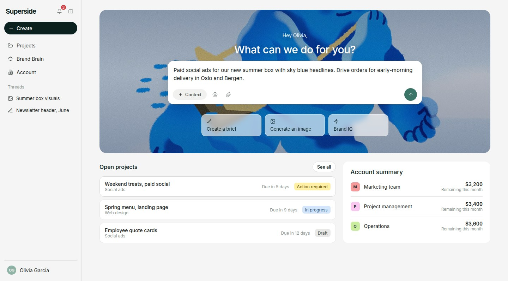
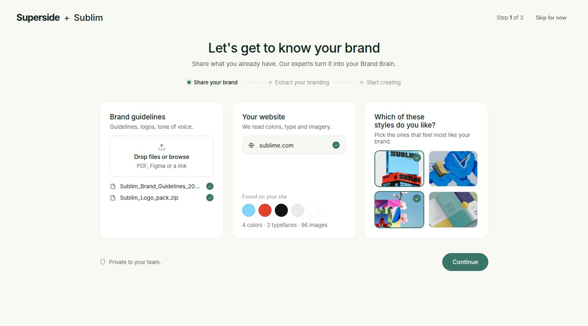
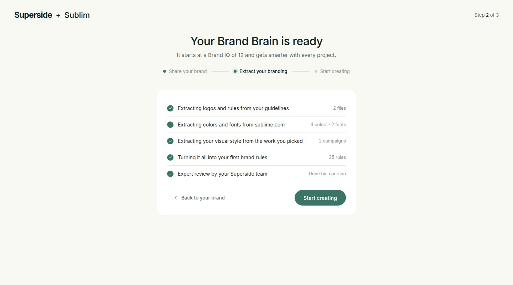
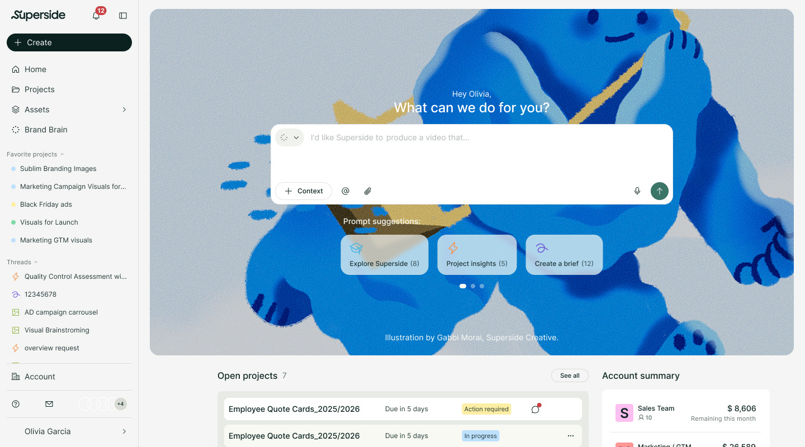
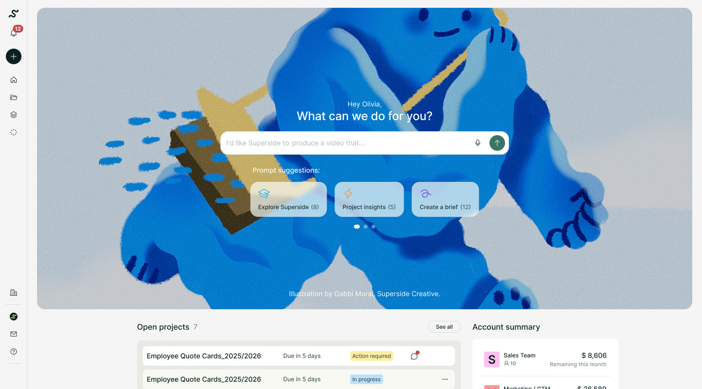

# Turning a project management tool into a brand brain ~ 42% less churn

*Superspace is where Fortune 500 marketing teams order creative work from Superside. The designers on each account kept changing, and every time, what they knew about the brand left with them. So clients kept re-explaining their brand. I designed Brand Brain: one shared memory per brand, used by four AI agents, with people making the final call. I also designed the growth flow around it.*

::: prototype prototype.html
Try the prototype first
Click through it before reading the case
:::

::: tags
- AI agents
- Knowledge systems
- Growth: onboarding → engagement
- B2B SaaS
- Enterprise
:::

| Result | Value |
|---|---|
| **Account churn** | −42% |
| **Adoption** | 80% |
| **Faster project review** | 30% |
| **Customer satisfaction** | +25% |

::: sphere Interactive Brand Brain sphere: the creative work, feedback and brand assets it remembers
title: Brand Brain
text: Every brief, round of feedback and final asset, remembered
hint: Drag or scroll to spin
sprite: sphere-tiles.jpg
caption: Brand Brain: every piece of work a brand has made with Superside, in one memory that the agents read from.
tile: https://cdn.sanity.io/images/k0dlbavy/production/127ae340a16c499de27c45907a0e7797a6b4ceca-768x772.jpg?w=240&h=240&fit=crop&auto=format&q=80
tile: https://cdn.sanity.io/images/k0dlbavy/production/b0586bf52ff0f80b648dd0004136a78a66c10f01-500x500.jpg?w=240&h=240&fit=crop&auto=format&q=80
tile: https://cdn.sanity.io/images/k0dlbavy/production/6dce4fbbd45ac18becf627777e51a71cf4acfa0c-500x500.jpg?w=240&h=240&fit=crop&auto=format&q=80
tile: https://cdn.sanity.io/images/k0dlbavy/production/62829a2f0fcf1b40ea3c4fcd815b6f2281666a1d-500x500.jpg?w=240&h=240&fit=crop&auto=format&q=80
tile: https://cdn.sanity.io/images/k0dlbavy/production/bae2609198801d9058d7c0c4a8cd29d73c915038-500x500.jpg?w=240&h=240&fit=crop&auto=format&q=80
tile: https://cdn.sanity.io/images/k0dlbavy/production/479069d7678e3b19fe32ba1101ae5bc4881ac339-500x500.jpg?w=240&h=240&fit=crop&auto=format&q=80
tile: https://cdn.sanity.io/images/k0dlbavy/production/f8f048bf631fadb90dac2cbcd69b078becac2c01-500x500.jpg?w=240&h=240&fit=crop&auto=format&q=80
tile: https://cdn.sanity.io/images/k0dlbavy/production/a5460ef263c81c4a9fd0fba2394d41178eb14c82-500x500.jpg?w=240&h=240&fit=crop&auto=format&q=80
tile: https://cdn.sanity.io/images/k0dlbavy/production/959ef792b10d03d8f57a008fbc52f48d62fefbf1-500x500.jpg?w=240&h=240&fit=crop&auto=format&q=80
tile: https://cdn.sanity.io/images/k0dlbavy/production/371f375d3203671abb2c30bad53f8574827d5fde-500x500.jpg?w=240&h=240&fit=crop&auto=format&q=80
tile: https://cdn.sanity.io/images/k0dlbavy/production/5b1e8e3f3218f858edb2718d9cee8776c23d7dac-500x500.jpg?w=240&h=240&fit=crop&auto=format&q=80
tile: https://cdn.sanity.io/images/k0dlbavy/production/50ab8c3d9bdc4a05ee9d9b5176adcb415b2d696c-500x500.jpg?w=240&h=240&fit=crop&auto=format&q=80
tile: https://cdn.sanity.io/images/k0dlbavy/production/080e9c2c81117d117537a7973e74c85ae70f4bf6-500x500.jpg?w=240&h=240&fit=crop&auto=format&q=80
tile: https://cdn.sanity.io/images/k0dlbavy/production/c5b9214c4b9a6e76644682c2fc5991a650a8e232-500x500.jpg?w=240&h=240&fit=crop&auto=format&q=80
tile: https://cdn.sanity.io/images/k0dlbavy/production/86479ee143b02458ef68ecfe023d6cb1f75df9a3-500x500.jpg?w=240&h=240&fit=crop&auto=format&q=80
tile: https://cdn.sanity.io/images/k0dlbavy/production/64b7c535030e1c2c02a22410cf9ff53581f59c25-500x500.jpg?w=240&h=240&fit=crop&auto=format&q=80
tile: https://cdn.sanity.io/images/k0dlbavy/production/4d402b77ce9d964298ee8bcdf6e316ba9bada729-500x500.jpg?w=240&h=240&fit=crop&auto=format&q=80
tile: https://cdn.sanity.io/images/k0dlbavy/production/fd9d7929d894e37ecb6168028cee10583680b62e-500x500.jpg?w=240&h=240&fit=crop&auto=format&q=80
tile: https://cdn.sanity.io/images/k0dlbavy/production/30b1731376f75013e2baf91da5c097273e2b6e5c-500x500.jpg?w=240&h=240&fit=crop&auto=format&q=80
tile: https://cdn.sanity.io/images/k0dlbavy/production/0e7b6670c17df1c1ef6e41dae96284e2f288aaa8-500x500.jpg?w=240&h=240&fit=crop&auto=format&q=80
tile: https://cdn.sanity.io/images/k0dlbavy/production/4a5f5de24a943ea5d6cfc91bc268324dd8a54e03-500x500.jpg?w=240&h=240&fit=crop&auto=format&q=80
tile: https://cdn.sanity.io/images/k0dlbavy/production/606deac34f0d22ddaa55408504e69295d6439d1a-500x500.jpg?w=240&h=240&fit=crop&auto=format&q=80
tile: https://cdn.sanity.io/images/k0dlbavy/production/cba6c38ed100e2b2055e26144e366b2acd64fad8-500x500.jpg?w=240&h=240&fit=crop&auto=format&q=80
tile: https://cdn.sanity.io/images/k0dlbavy/production/f003564f4cc8db38f764210207e0b01046fd20c7-500x500.jpg?w=240&h=240&fit=crop&auto=format&q=80
tile: https://cdn.sanity.io/images/k0dlbavy/production/fc0e8faf59408c211f61516fa49444387ac78236-500x500.jpg?w=240&h=240&fit=crop&auto=format&q=80
tile: https://cdn.sanity.io/images/k0dlbavy/production/0ad760891b2d4cfe9225464333f0101e98a2b548-500x500.jpg?w=240&h=240&fit=crop&auto=format&q=80
tile: https://cdn.sanity.io/images/k0dlbavy/production/1390abcc1530b86c7033379c27bcdfd05ad00f84-500x500.jpg?w=240&h=240&fit=crop&auto=format&q=80
tile: https://cdn.sanity.io/images/k0dlbavy/production/8145ee0d4ad0f26b5eace627230d554203571552-500x500.jpg?w=240&h=240&fit=crop&auto=format&q=80
:::

## Project overview

| | |
|---|---|
| **Role** | Lead Product Designer |
| **Team** | Product manager, AI and platform engineers, creative ops, account management |
| **What I did** | Discovery, agent model, UX and UI, the growth flow from onboarding to engagement, and shipping code to production for new features and fine tuning |
| **Timeline** | Q4 2025 ~ Jun 2026, launched Mar 2026 |

## 01 — Every rotation reset the brand to zero {The problem}

Superside's creative teams rotate between Fortune 500 accounts. Superspace saved the projects, not what the team learned, so the knowledge left with them.

::: rotation What happened every time the team on an account changed
- **Team A** — Knows the brand
- Team changes
- **Team B** — Starts from zero
- Result
- **Brand owner** — Explains the brand again — ↻ every few weeks
:::

## 02 — It wasn't a process problem. It was a memory problem. {Discovery}

We started with discovery, to learn why accounts were leaving before deciding what to build.

::: numbers
- **4** teams — core, subscription, marketing and brief
- **32** people interviewed — 12 brand owners · 14 creatives · 6 PMs
- **8** accounts — churned, at-risk and healthy
:::

::: insights Insight
- **Knowledge gets lost between projects** — Nobody owned what happened after a project ended. That's where it disappeared.
- **We already had the knowledge** — Briefs, feedback and assets were all in Superspace. They just weren't connected.
- **Old feedback goes out of date** — Rules change. The memory has to know which one is true today.
- **No source, no trust** — Brand owners only trust AI if they can see where an answer came from, and fix it.
:::

::: question The question we designed against
How might we make brand knowledge survive the people who hold it?
:::

### What we agreed on before building

::: principles
- Agents suggest, people decide
- Every suggestion shows its source
- Correcting the brain takes one click
- One voice, not four — Added after V2
:::

## 03 — Three ways to give a brand a memory {Three directions}

Three ways in, from cheapest to boldest. Each was scored on the same five things.

::: directions Three directions scored on five criteria
- **Handover kit** — 01 · Process — Notes when the team changes — Runs on discipline
- **Search bar** — 02 · Search — Old briefs, made searchable — Outdated, can't find the unknown
- **Brand Brain** — 03 · Agents + memory — A living model of the brand — Chosen
Survives rotation: 1 2 3
Easy for brand owners: 2 3 2
Easy for creatives: 1 2 3
Improves over time: 0 1 3
Cheap to build: 3 2 1
_More dots = stronger. Brand Brain lost on cost, and we said so._
:::

It was the riskiest option, so I showed it instead of pitching it: a prototype on a real account's history. When it caught a correction the brand had already made, the question changed from “can we afford this?” to “what's the smallest version we can ship?”

::: next What changed next
Engineering's first instinct was the fastest path to something working: one assistant with access to everything. V1 tested that.
:::

## 04 — One assistant that knows everything {Version 1 ~ One assistant}

We connected a single general assistant to an account's full history ~ briefs, comments, assets, approvals ~ and asked it to help with the next brief.

::: shot sketch-v1.png sketch
alt: Simplified sketch of the V1 prototype: the brand owner asks for a summer social brief and one assistant, reading the whole account, answers with a generic brief and 1,284 sources
caption: Simplified sketch of the V1 prototype
- One assistant, reading everything at once.
- Plausible, but it could be any brand.
- “1,284 items” says nothing about why.
:::

::: data The V1 test · 3 accounts · 40 briefs
- good **82%** — found the right past feedback
- good **9 of 12** — owners wanted to keep it
- bad **41%** — briefs broke a brand rule (by hand: 27%)
**So:** keep the memory, split the work.
:::

::: next What changed next
7 in 10 failures came from one assistant doing every job. Real projects split the work, so V2 did too.
:::

## 05 — Four agents, one memory, all talking at once {Version 2 ~ Four agents}

Four agents, one per step of a real project, all sharing one memory. A person always decides.

::: model The agent model ~ one project, end to end
- **Ideate** — Strategist — “What has worked for this brand before?” — The brand owner picks a direction
- **Brief** — Project Manager — “Is this brief ready for the team?” — The brand owner submits the brief
- **Create** — Creative — “What could this look like?” — The Superside team produces the work
- **Review** — Brand Owner — “Would the brand sign this off?” — The brand owner approves
- **Learn** — Brand Brain — Approved work and feedback become new memories — No handover doc needed
legend: Agent — Person decides
memory: Brand Brain · shared memory — The brand, The work, The people — Every agent reads from it. Every decision writes back.
:::

The first prototype showed everything: the agents chatting, next to the raw graph.

::: shot sketch-v2.png sketch
alt: Simplified sketch of the V2 prototype: a brief thread where four agents discuss and rewrite the brief, next to the raw knowledge graph with 20.1K nodes and 576 edges
caption: Simplified sketch of the V2 prototype
- Four voices to read before anything happens.
- The brief was rewritten without asking.
- The memory, shown as a graph.
:::

### How we worked with engineering

::: features
- **Real data from week one** — Prototyped in code, on real accounts.
- **A job description per agent** — One question, turned into tests.
- **Weekly output reviews** — Memory, agent or interface problem?
:::

::: data What the data said · 6 accounts · 120 briefs · 4 weeks
- good **41% → 11%** — briefs broke a brand rule (by hand: 27%)
- good **18% → 54%** — ready on the first pass
- bad **1 in 3** — agent changes were undone by the brand owner
**So:** the model stayed, the interface didn't.
:::

::: insights Problem
- **Too much to read** — People wanted answers, not a debate.
- **Overruled** — Briefs were rewritten without asking.
- **A graph nobody could read** — Meaningless to brand managers.
:::

::: next What changed next
Keep the agents, show one voice, suggest instead of rewriting.
:::

## 06 — Same four agents. One voice, and the brand owner decides. {Version 3 ~ One voice}

Shipped in March 2026. People see the result, the reason and the source.

::: features
- **One voice, reasons on demand** — One status line, steps and sources one click away.
- **Suggest, don't overwrite** — Every suggestion cites its source. Accept or dismiss.
- **The brain in the brand's language** — The graph became a brand profile.
- **A Brand IQ** — A score for what the brain knows.
- **Provenance in the data model** — Source and approver stored with every memory.
:::

::: shot 09-profile-v5.jpg side
alt: Brand Brain profile for Sublim: Profile and Brand IQ tabs, graph stats, fonts and colors, logo usage, tone of voice and brand models
intro: The memory, made visible and correctable.
- 67.0 19.0 **Brand profile** — How much the brain knows, and when it last synced.
- 19.6 26.7 **Foundations** — Fonts and colors, as the brand defines them.
- 19.6 53.6 **Logo usage** — Which logo goes where. No longer in one designer's head.
- 19.6 75.8 **Tone of voice** — How the brand sounds.
- 58.6 75.8 **Brand models** — Image styles the Creative agent uses.
:::

**A brain needs a score.** Owners kept asking “how much does it know about us?” So every Brand Brain gets an IQ that grows as they review and fill gaps.

::: shot 15-brand-iq-v5.jpg
alt: Brand IQ screen: an IQ score of 12 at Level 1 with a plain summary, a Review section with six rules waiting for a yes, and a Missing section with three things to add
caption: Brand IQ: how much the Brand Brain knows, and what it still needs
- 30.6 19 An IQ score and level, with a plain summary of what the brain knows.
- 19.2 38.4 Review: rules the agents learned, waiting for a yes.
- 19.2 72.5 Missing: what the brain still lacks. Adding it raises the IQ most.
- 86 37.6 People validate every rule. Nothing becomes brand truth on its own.
:::

**How a brief starts.** Press Create, type what you need, send. No form.

One message becomes a full brief, filled from memory, with the gaps flagged.

::: shot 12-brief-check-v5.jpg
alt: Project brief with four fields filled from brand memory, each with its source, and the Project Manager agent's suggestions as cards on the right, each with its own Dismiss and Add to brief buttons
caption: Step 2 · Brand Brain turns it into a brief, and checks it
- 6.7 12.3 One status line instead of four agents talking.
- 60.2 39.6 Every filled field says where it came from.
- 71.6 29.6 Suggestions, never silent rewrites.
- 79 48.6 You pick what goes in. Dismissals teach the brain too.
:::

::: next What changed next
Next: how customers get to the brain, pay for it and come back.
:::

## 07 — Around the brain: onboarding → activation → buying → engagement {Growth flow}

I owned this flow end to end, around one idea: show the brain working as early as possible.

::: growth Growth flow
labels: The moment that matters — What I designed
- **Onboarding** — The brand's context is in — Share your brand, extract your branding
- **Activation** — The first on-brand brief or image — Create prompt, brief check, first image
- **Buying** — Budget stays ahead of the work — Team balances, boosters with manager approval
- **Engagement** — Coming back without an open project — New project highlighted, Brand IQ: review and missing
loop: Every new project teaches the brain
:::

### 01 · Onboarding {Goal: the brand's context is in}

People share what they have, and we extract the rest.

::: rotate 1 · Create your account · the artwork changes every 5 seconds to show Superside's range
- 00-signup.jpg — Create your account: Superspace sign-up with Google or email, next to a collage of Superside creative work. Tagline: Your brand's brain.
- 00-signup-2.jpg — The same sign-up screen with a different collage and a light blue background
- 00-signup-3.jpg — The same sign-up screen with a different collage and a sand background
:::

### 02 · Activation {Goal: the first on-brand brief or image}

The first brief or image uses the brand's memory.

Type an idea, get an on-brand image, turn it into a project.

::: shot 04-image-generation.jpg
alt: Image generation thread: a collapsible status line, the generated on-brand image, and buttons to create a brief or download
caption: From a prompt to an on-brand image, in one conversation
- 34 22.6 The agent's work folds into one line you can open.
- 29.4 37 Generated with the brand's own models.
- 29.4 84.5 Create brief hands the idea to the human team.
:::

### 03 · Buying {Goal: budget stays ahead of the work}

Spend is visible early, and boosters need a manager's code.

::: shot 13-booster-v5.jpg
alt: Account balance with Marketing running low, and a drawer to add a booster that previews the Marketing team budget going from 1,400 to 5,400 dollars before paying
caption: Add a booster
+ 13-booster-approval-v5.jpg — The subscription manager approves with a code — Approve this booster: the amount, the subscription manager who approves it and a 6-digit approval code
+ 07-balance-v5.jpg — Balance: how the budget adds up — Balance: available budget per team with used and not used totals, and a card showing how the available budget adds up
- 37.4 31.2 A low team balance is flagged before work stalls.
- 89.6 52.3 The effect of the booster, shown before paying.
- 67 64.6 Topping up often leads to a bigger plan, not more friction.
- A code from the subscription manager approves every booster, like a bank check.
:::

### 04 · Engagement {Goal: coming back without an open project}

A new project leads back to the brain, so each one makes it smarter.

::: shot 17-projects-submitted-v5.jpg
alt: Projects list right after submitting a brief: the new project is highlighted in green at the top, with a Check Brand Brain button below the list
caption: After submitting: the new project, then the brain
- 19 19 Your new project, highlighted for a few seconds.
- 50 67.5 One click from a project into Brand IQ, to review and fill in what's missing.
:::

## 08 — A memory that stays when people move {Impact}

Brand owners stopped re-explaining their brand every time the team changed.

| Result | Value |
|---|---|
| **Account churn** | −42% |
| **Adoption** | 80% |
| **Faster project review** | 30% |
| **Customer satisfaction** | +25% |

## 09 — What I'd keep doing {Takeaways}

::: insights
- **Split the AI the way the team splits the work** — One job per agent made problems easy to find.
- **Suggest, don't overrule** — People undid 1 in 3 silent changes.
- **Show the answer, not the conversation** — The result first, the reason one click away.
- **Always show where an answer came from** — A small source on every field built trust. Add it from day one.
:::

::: try prototype.html
Try it yourself
Click through the Brand Brain prototype
A working version of Superspace. Set up a brand, type a request and watch the agents fill the brief, generate an on-brand image, raise the Brand IQ and top up a budget.
Open the prototype →
:::
