# Designing 3D story maps for newsrooms

*A 3D map in the Mapcreator tool that lets newsrooms rebuild how a story unfolded: where it happened, in what order, and along which routes.*

Oct 9, 2026 · Alessandra Stagno

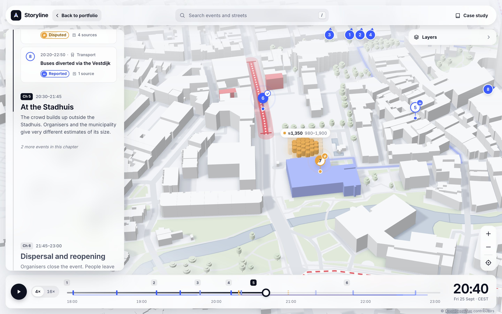

In 2022, my team at Mapcreator asked me to bring story maps into the Mapcreator tool: a story map template.

I created the concept and tested it in two rounds. After that, customers started using it in their newsrooms to explain news stories, including reconstructions of sensitive events that retraced the routes taken by the people involved.

Out of respect for the people in those stories, and for our customers' confidentiality, I don't name the stories or the newsrooms. The visuals in this case study come from Storyline, a recreation of the concept with an invented story.

**A static map shows where something happened. A story map has to show how it happened: in order, in place, and in a way readers can follow without losing the thread.**

## Project overview

| | |
|---|---|
| **Year** | 2022 |
| **Company** | Mapcreator |
| **Role** | Lead Product Designer · concept, UX and UI |
| **Brief** | A 3D map in the Mapcreator tool that lets users build story maps |
| **Validation** | 2 rounds of tests |
| **Used by** | Newsrooms explaining news stories |

## 01 — The brief

Newsrooms used Mapcreator to make maps for their stories. The request from my team was to go further: a 3D map on which users could build a whole story, so an event could be told through its places, its sequence and its routes.

The stories that are hardest to explain on a map are the ones that move. When a story is about what happened, where and in what order, a single pin or a line on its own isn't enough. Readers need to follow the sequence without losing track of where they are.

The question behind the concept:

**Can a reader follow what happened, where and in what order, within seconds and without losing the thread?**

## 02 — Discovery

After the brief, I ran a small discovery. I talked with 5 customers to understand the kinds of stories they tell in their newsrooms, and what a story map has to do for them.

These are the insights that shaped the concept:

- **Order comes first.** Their stories are about what happened and in what order, so time has to be part of the map, not a caption under it.
- **Routes carry the story.** Many follow a person or a group through the streets, so a single pin is not enough.
- **Readers need to see what is known.** Newsrooms want to show how well each fact is sourced, and to show competing claims side by side.
- **A quiet map works best.** Especially for sensitive events, the map should stay calm so the story stands out.
- **It has to fit the workflow.** The map lives inside an article, so it must embed and link to an exact moment.

## 03 — Two rounds of testing

I tested two earlier prototypes before arriving at the final one.

::: timeline
- **The brief** — My team asks for story maps in the Mapcreator tool
- **Discovery** — Five customer conversations about newsroom stories
- **Round 1** — From map pins to a chronological story
- **Round 2** — From visual exploration to verified reporting
- **The final prototype** — Time, movement and evidence in one interface
- **Newsrooms** — Customers start telling stories with it
:::

### Test 1: From map pins to a chronological story

**Hypothesis:** Readers need to follow how an event unfolds across locations, not just see where things happened.

- **Prototype:** A 3D map with event pins and a list of story highlights.

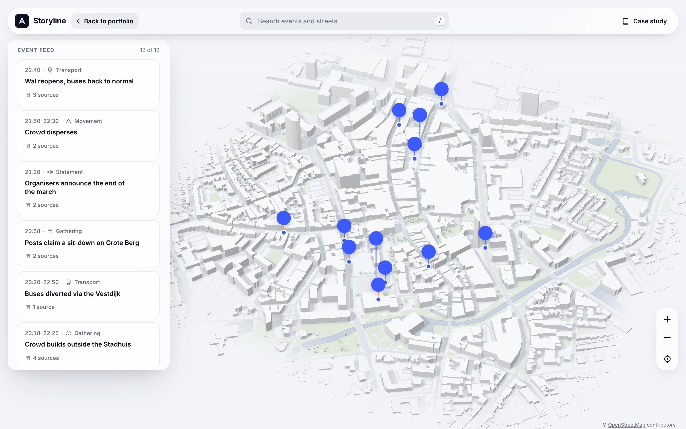

- **Fictional findings:** 5/8 readers jumped between pins without understanding the sequence. Readers following a march also struggled to understand its direction of movement.

**What changed:** Added a timeline, numbered events, and a connected route. Selecting an event now moves the reader to its location and moment in the story.

### Test 2: From visual exploration to verified reporting

**Hypothesis:** Readers need context and evidence to understand what is confirmed, estimated, or disputed.

- **Prototype:** A synchronized map and story panel with timestamps and source links.

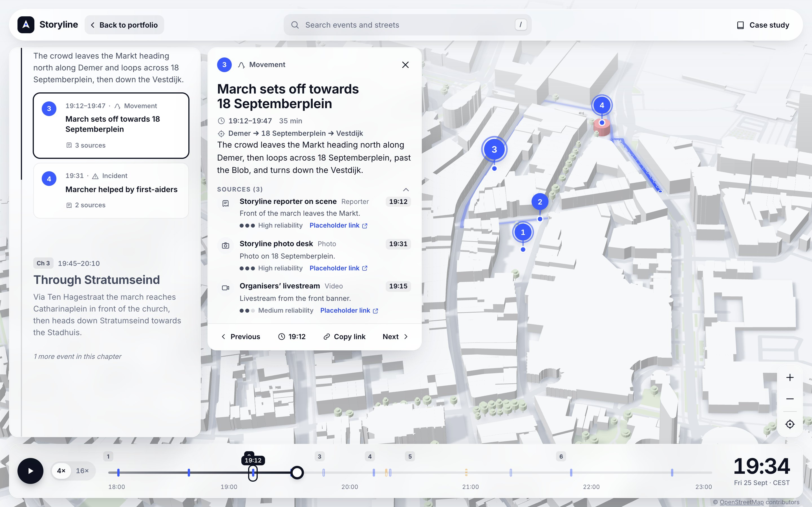

- **Fictional findings:** 4/7 readers mistook estimated crowd sizes for exact counts, while journalists wanted to distinguish verified observations from competing claims.

**What changed:** Added visible verification status, source counts, explanatory notes, and ranges for estimates. Simplified the map styling so the narrative remained the focus.

## 04 — The final prototype

The final prototype combines time, movement and evidence in one interface. The timeline controls the story, the 3D map gives the geographic context, and each event has a precise moment, a verification status and traceable sources. Embeddable, deep-linked moments make it practical for newsroom publishing workflows.

These are its core ideas, shown here in Storyline.

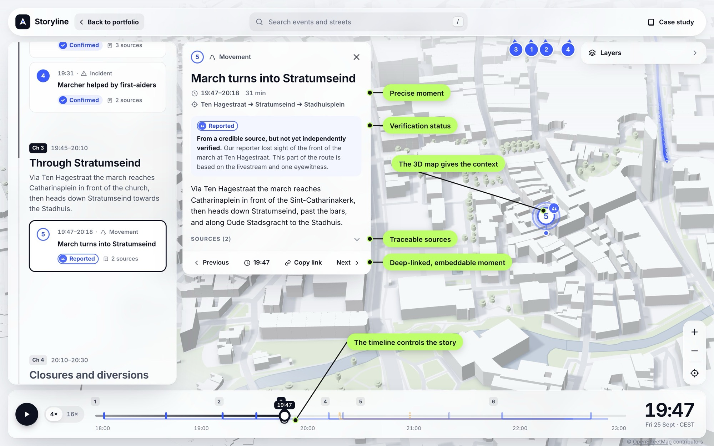

### 1. Time drives the map

The story lives on a timeline. Readers can play it, drag through it or jump to a chapter, and the map always shows the state of the story at that moment: which events have happened, where people moved and which roads were closed.

Every view is derived from the same moment in time, so the map, the timeline and the text can never disagree.

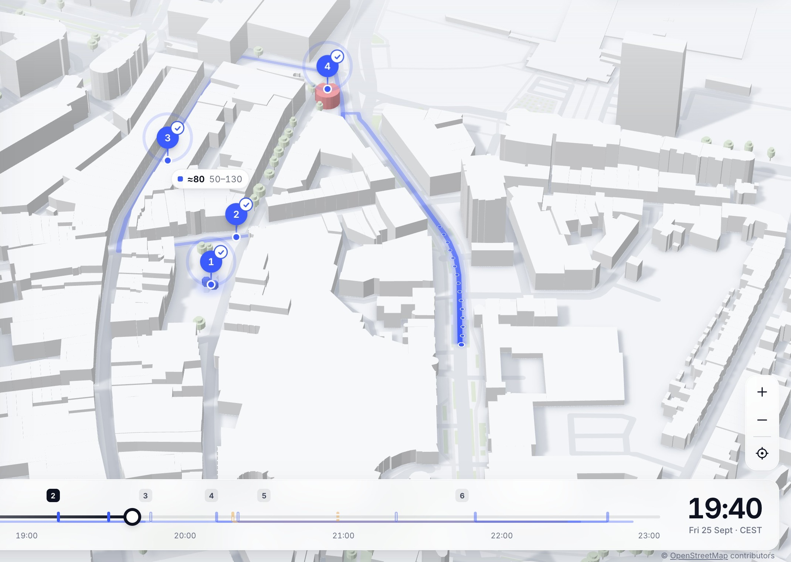

### 2. Routes, not just points

The stories newsrooms told with it often retraced the routes people took. Movements are drawn along the real streets, with dots and a fading trail that show where a group came from and where it is now.

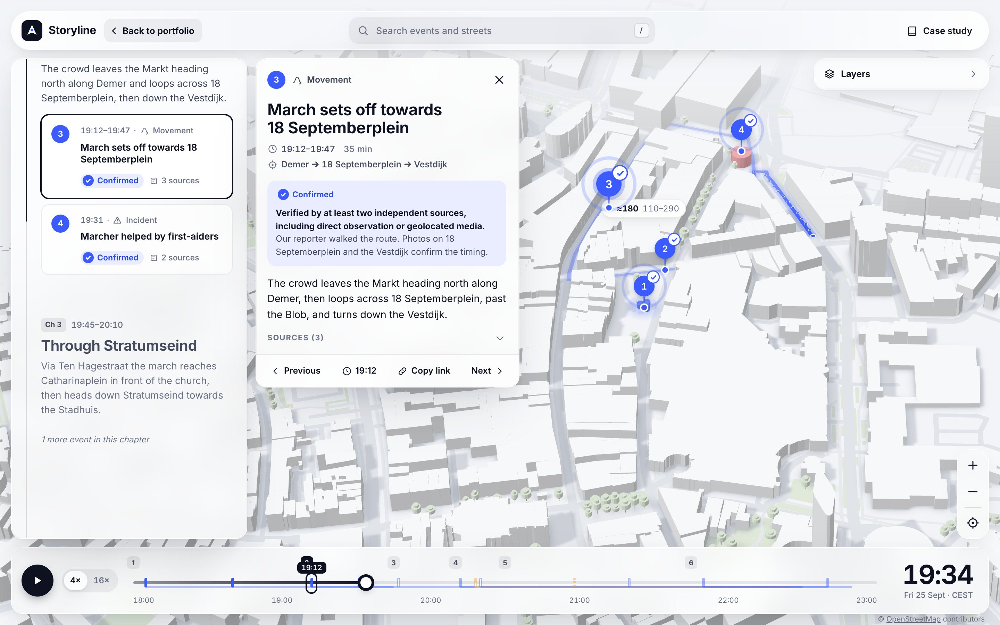

### 3. 3D context that stays quiet

Buildings give readers landmarks. The places that matter to the story are highlighted, numbered pins sit on rooftops and street corners, and everything else stays in a neutral clay style so the story stands out. For sensitive reconstructions, that restraint matters.

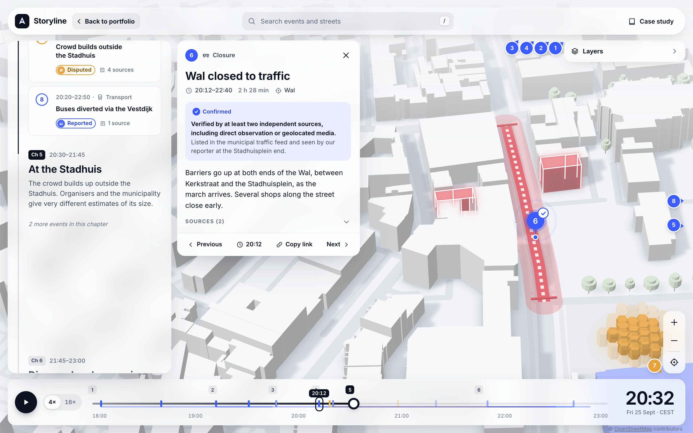

### 4. Show what is known, and how well

Each event carries its sourcing: confirmed, reported, unverified or disputed. Colour never carries the difference alone: fill, outline, dashes, a split and a small glyph tell the levels apart. Crowd sizes show a range rather than one falsely precise number, and disputed figures show each competing claim.

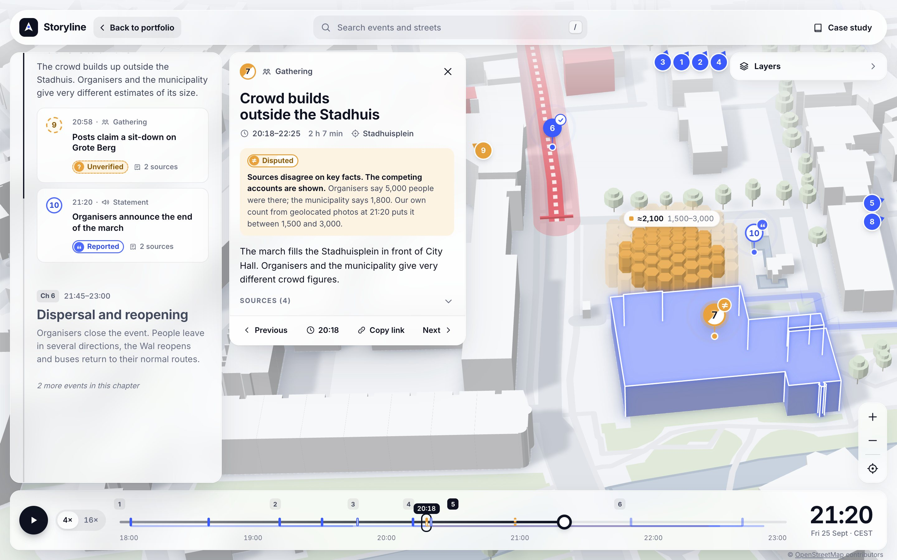
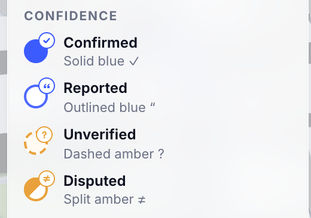

### 5. Built into the newsroom workflow

One story file drives everything, so a newsroom can swap in its own story without touching the map. The same story works as a scroll-driven article, as a map readers explore freely and as an embed inside an article, and a link can point to an exact moment and event.

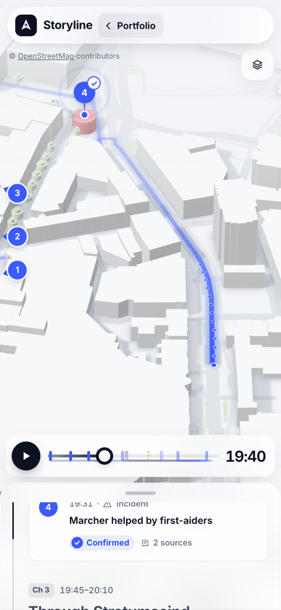
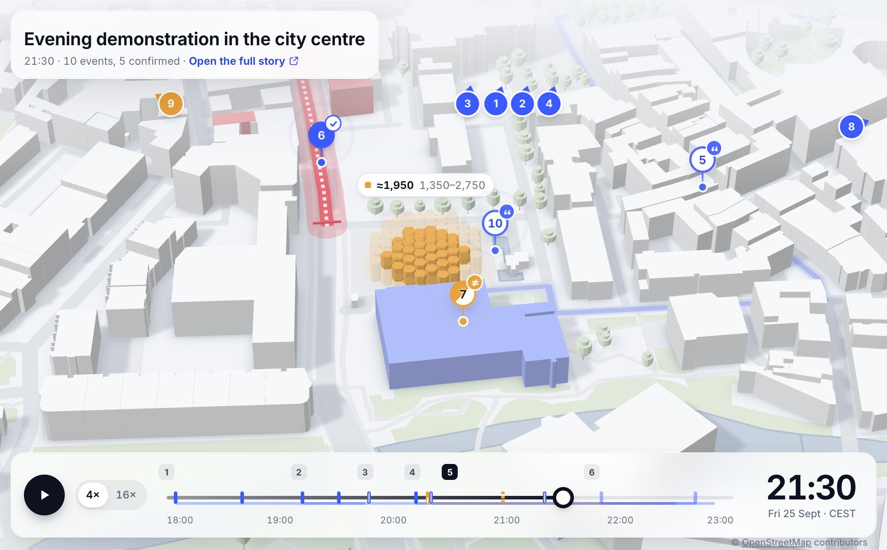

## 05 — In newsrooms

After the second round, customers started using it in their newsrooms to explain news stories. Many were reconstructions of sensitive events, retracing step by step the routes taken by the people involved.

Those stories aren't mine to share, so I don't name them or the newsrooms that published them.

## 06 — Recreating it as Storyline

To show the concept without exposing real stories, I rebuilt it as Storyline: a story map of an invented evening demonstration, on real OpenStreetMap data of central Eindhoven. The events, times, crowd figures, quotes and sources are all invented. Only the streets and buildings are real.

::: launch
[Open the live prototype](../../dispatch.html)
:::

## 07 — What I took away

This project taught me that a map is more than a way to show where something happened. It can help people understand how an event unfolded, what is known about it, and where uncertainty remains.

The biggest design challenge was bringing time, movement and evidence together without overwhelming the reader. Each decision had to make the story easier to follow, while keeping the map calm and the information trustworthy.

A good story map doesn't just show readers where to look. It helps them understand what happened, one moment at a time.
