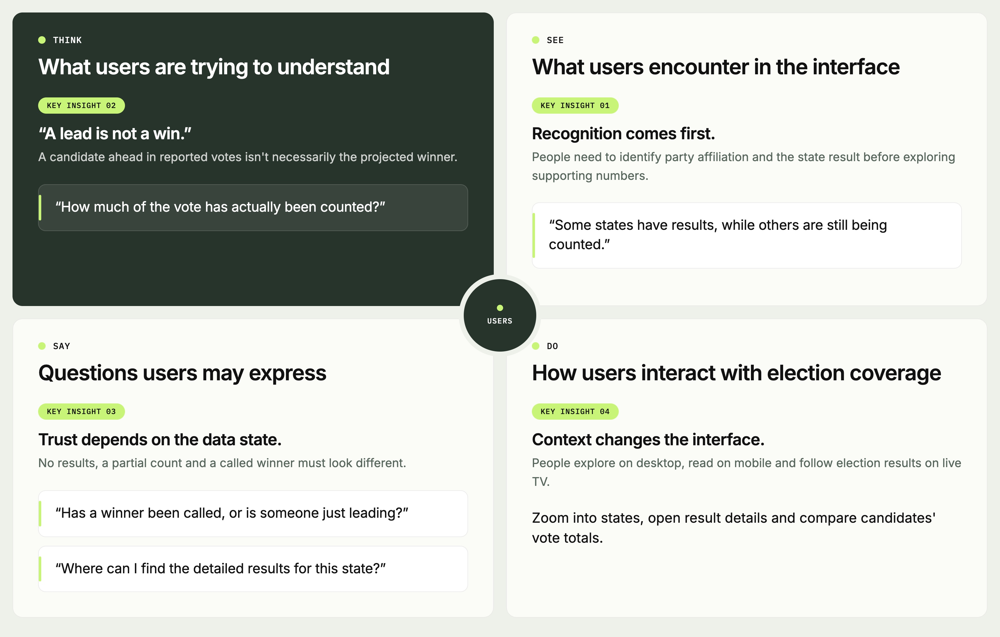
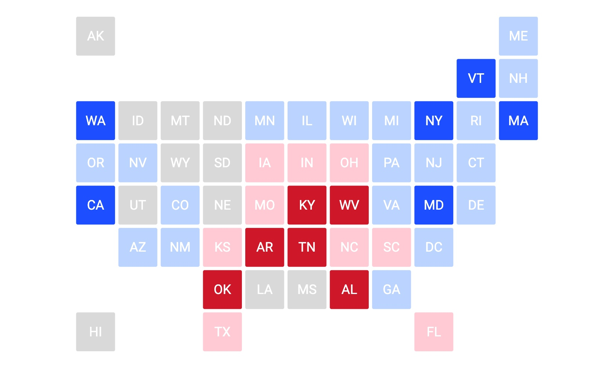
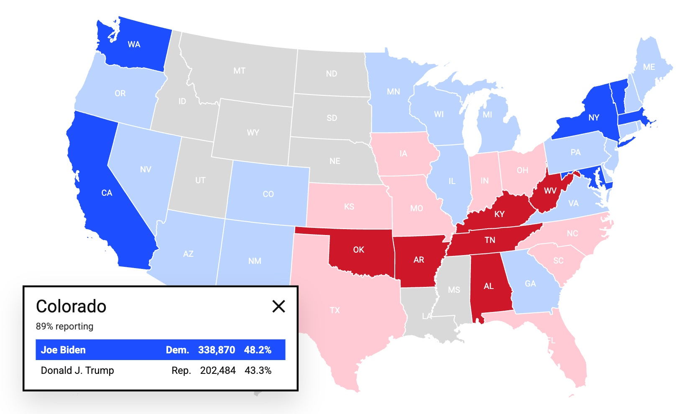
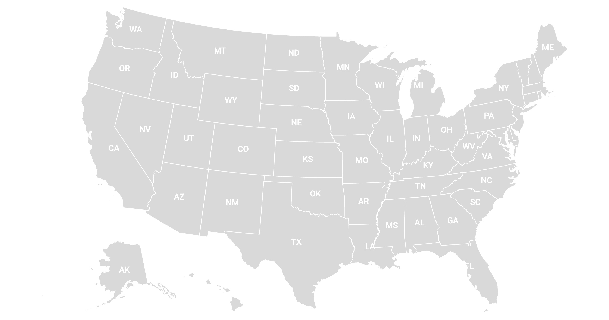
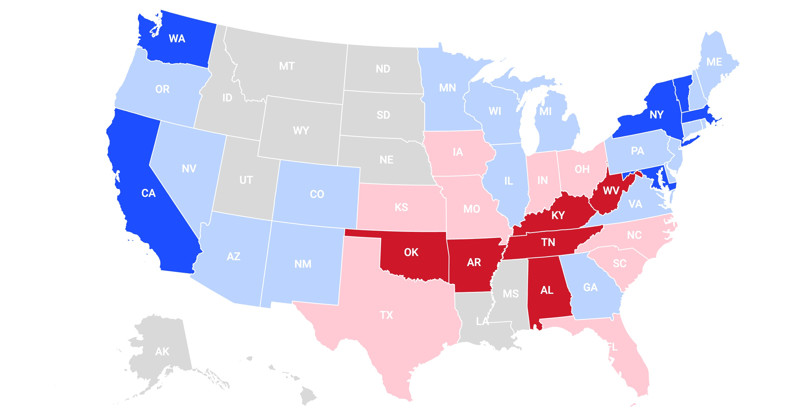
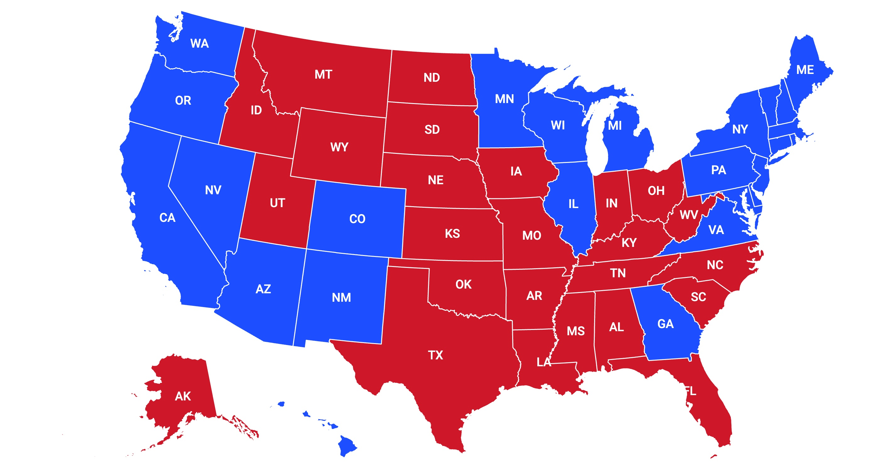
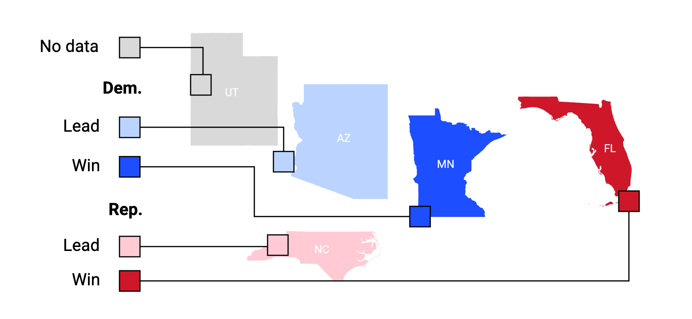
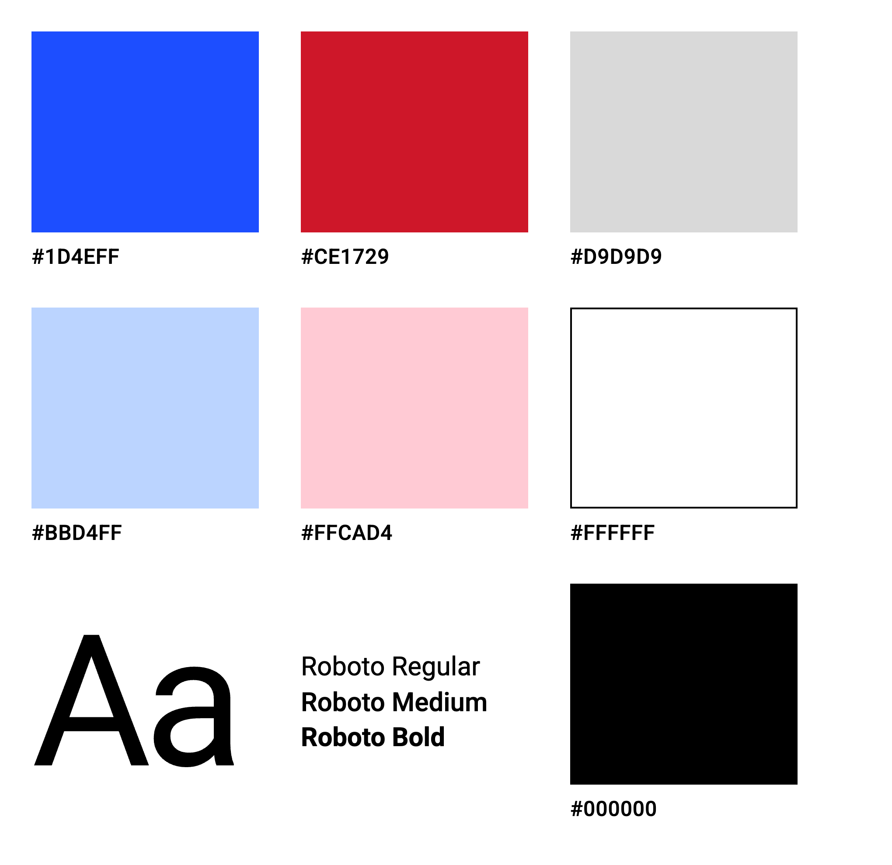
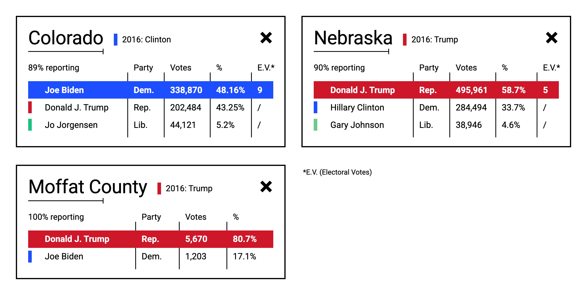

# Designing the live 2020 US election map for newsrooms

*Turning complex, constantly changing election data into a map people could understand in seconds, shipped in four weeks.*

Oct 9, 2026 · Alessandra Stagno

, RTL Nieuws (the Netherlands) and Berlingske (Denmark) used it during live coverage.")

I led the design of Mapcreator’s live US election map for the 2020 election. Newsrooms embedded it on their websites and used it during live TV coverage. We designed and shipped it in four weeks, using a live Reuters results feed.

The map reached more than 6 million unique visitors, helped Mapcreator win 20 customers within a year, and established a live-data capability reused for later elections.

**The challenge wasn't simply to visualize election results. It was to make complex data understandable in seconds, across screens, while results were changing live.**

## Project overview

| | |
|---|---|
| **Role** | Lead Product Designer, sole designer |
| **Team** | 1 Product Manager, 5 full-stack developers, 30+ testers |
| **Scope** | Research, UX, UI, prototyping and color system |
| **Timeline** | 4 weeks: 1 UX, 1 UI, 2 development |
| **Platforms** | Desktop, mobile, iPad and broadcast |
| **Data** | Live Reuters election results feed |

## 01 — The challenge

Mapcreator saw the 2020 US election as an opportunity to demonstrate how its mapping platform could bring live data into newsroom workflows.

The deadline was fixed: election day was November 3, 2020. We had four weeks to design and build a product that newsrooms could publish during one of the world's most closely watched political events.

A map that was difficult to read or misleading about the state of the count would undermine both newsroom coverage and Mapcreator's credibility.

I reframed the brief around one question:

**Can someone understand the result for a state within seconds, at any point in the count, without confusing a lead with a win?**

This became the principle behind our research, design decisions and validation.

## 02 — Research and validation

I reviewed competitor election maps, studied an earlier interactive US election map, interviewed users about how US elections work, and surveyed US respondents through Lyssna. I also gathered feedback from newsroom customers about their live coverage needs.

Four insights shaped the experience:

- **Recognition comes first.** People need to identify party affiliation and the state result before exploring supporting numbers.
- **A lead is not a win.** The candidate ahead in reported votes isn't necessarily the candidate projected to win.
- **Trust depends on the data state.** No results, a partial count and a called winner must look different.
- **Context changes the interface.** Desktop exploration, mobile reading and live TV require different interaction patterns.

I translated these insights into four design principles: readability in seconds, a clear distinction between a lead and a win, trustworthy data states, and a consistent visual system adapted to each surface.

## 03 — Key design decisions

### 1. Choose the map people could read most easily

A geographic map preserves familiar state positions, but large states dominate the screen. A tile map gives states more equal space but changes their familiar geographic relationships. A cartogram was another possibility, but it was too complex to deliver within four weeks.

Rather than commit based on preference, I tested the map concepts in three rounds. I set a benchmark of **at least 4 out of 5 for ease of reading** before moving forward with the high-fidelity design.

**Round 1: Tile map**

**3.1/5 · 10 participants**

Participants struggled to orient themselves in the grid and find states without familiar geographic positions.

**What changed:** I shifted the primary direction towards a geographic map, prioritizing recognition and orientation over uniform state sizing.

**Round 2: Geographic map**

**3.8/5 · 10 participants**

State recognition was more intuitive, but the distinction between a leading candidate and a called winner needed strengthening. Vote totals and reporting progress also competed for attention.

**What changed:** I refined the information hierarchy, clarified the color states and made the leading result and reporting progress easier to scan.

**Round 3: Refined design**

**4.3/5 · 10 participants**

The refined design exceeded the 4/5 benchmark, supporting the decision to move forward with the geographic map.

**What changed:** The design passed the usability gate and moved into development.

**The decision:** Ship the geographic map as the primary experience. The tile map introduced more orientation friction for this use case, although Mapcreator later offered Tilegram as an alternative way to explore election data.

### 2. Make the state of the count immediately visible

The map would remain live for hours, and its meaning needed to stay clear as results changed.

I designed a three-state color system:

- **No data:** neutral gray (`#D9D9D9`).
- **Leading:** a lighter tint of the party color.
- **Winner called:** the full party color.

Blue (`#1D4EFF`) and red (`#CE1729`) made party affiliation easy to scan. The legend used the same visual language, while candidate names and vote totals provided additional cues so the meaning wasn't dependent on color alone.

**The decision:** Treat the count as a changing product state, not simply a set of colored regions. Each state needed a clear and consistent meaning.

### 3. Prioritize the information that explains the result

A state color tells people who is leading or winning, but not why. The pop-up needed to provide supporting information without overwhelming the reader.

I established a hierarchy around candidate names, vote totals, electoral votes and reporting progress, with historical context available as secondary information.

The distinction between reported votes and the projected winner was especially important. The candidate leading the count at a particular moment isn't necessarily the eventual winner, and the popular vote alone doesn't determine the US presidential election.

**The decision:** Make the primary result easy to scan first, with supporting data available without competing for attention.

### 4. Adapt the experience to the screen

The same interaction couldn't work equally well across desktop, mobile and television.

- **Desktop:** A dynamic pop-up appears beside the selected state.
- **Mobile:** A static pop-up and legend provide a predictable interaction.
- **State detail:** Selecting a state reveals its counties and their results.
- **Broadcast:** A static pop-up can sit in the bottom-left corner, leaving room for other graphics.

The broadcast placement came from a newsroom customer's feedback. They needed the bottom-right area clear to discuss Florida during election analysis.

**The decision:** Keep the visual system consistent, but adapt the behavior to the context in which people use the map.

### 5. Reveal geographic detail progressively

Small states such as Rhode Island and Connecticut, as well as Washington, DC, are difficult to label at a national map scale.

Instead of shrinking every label to fit, I designed four zoom levels. The national view prioritized results; subsequent levels introduced state codes and connected callouts for small states, followed by abbreviations and full state names on desktop.

As users zoomed in, the callouts disappeared when states became large enough to label directly.

**The decision:** Reveal detail as the user's focus narrows, preserving a clean national overview without sacrificing access to information.

## 04 — Leading delivery in four weeks

As the only designer, I worked closely with the Product Manager and five full-stack developers to turn the research into a product we could ship on time.

- **Week 1 — Understand and decide:** Research, competitor review, early concepts and testing.
- **Week 2 — Define the experience:** Visual system, interactions and interactive Figma prototypes.
- **Weeks 3–4 — Build and validate:** Development using the live Reuters feed and refinement of the core experience.

My focus was on resolving the highest-risk decisions early: map representation, result hierarchy and the data states the interface needed to support.

The testing rounds gave the team a shared basis for evaluating the designs. Instead of debating personal preference, we could focus on whether the map helped people interpret election results.

## 05 — Impact

| Measure | Outcome |
|---|---|
| **Reach** | 6M+ unique visitors |
| **Customer acquisition** | 20 customers within a year |
| **Product reuse** | Live-data capability reused for later elections |
| **Partnership** | Reuters collaboration continued |

Newsrooms that used the map during live coverage included TVA Nouvelles and LCN in Canada, RTL Nieuws in the Netherlands, and Berlingske in Denmark.

The live-data capability was subsequently reused for French and Canadian elections, extending the value of the original investment beyond a single event.

For Mapcreator, the project demonstrated how customizable mapping and live data could support real newsroom workflows. It also established a capability that could be built upon rather than discarded after election night.

, RTL Nieuws (the Netherlands) and Berlingske (Denmark), with Reuters' announcement and press coverage.")

**Press coverage:** [InPublishing](https://inpublishing.co.uk/articles/mapcreator-partners-with-reuters-to-provide-customisable-mapping-tools-for-us-election-16861) · [Geospatial World](https://geospatialworld.net/blogs/reuters-ties-up-with-mapcreator-to-offer-customized-map-tools-for-us-elections) · [Mapcreator](https://mapcreator.io/us-election-2020/)

## 06 — What I would do differently today

**Bring broadcast customers into discovery earlier.** The request to reposition the pop-up showed how strongly the broadcast environment shaped the layout. Today, I would involve those customers in the first week, before committing to the main composition.

**Define business measures before launch.** I would agree with the PM on how to measure newsroom adoption, customer acquisition and revenue impact, including baselines and attribution.

**Explore alternatives faster.** I would use AI-assisted prototyping to build lightweight, realistic concepts earlier, especially for the tile map. The goal would be to compare approaches and learn sooner without investing in engineering before the direction was clear.

**Make uncertainty visible, focus on what matters to the user, and give the team enough clarity to move forward with confidence.**
